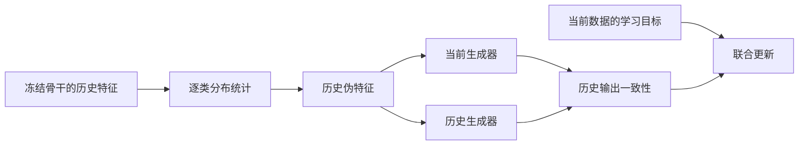

# 用生成式参数化学习实现在线适应

**Generative parameterization for online adaptation — prompt generation, statistical replay, and mechanism analysis.**

预训练模型已经具备尚可的基础表示能力，但是数据持续变化，模型仍需要学习。能否只更新少量参数，让模型学会新的判别方式，同时保留过去学到的能力？本项目以冻结的pretrained ViT为基础，围绕两件事展开：**用少量参数的 meta part 根据当前输入生成调制模型的 prompt，以及用压缩的历史特征分布约束后续更新。**

（**项目基于 [FlyGCL](https://github.com/AnAppleCore/FlyGCL) 开展方法扩展与分析**。本文保留研究设计和定性观察，展示相对baseline的相对进展和工作对比，不展示绝对 benchmark 数值）

## Part I · Generative online learning：高效参数学习

### 1. 输入端：从 routing+逐任务 prompts 到自适应 generator

**如何是把在线适应集中到一个小型、输入相关的生成模块？** 冻结的预训练骨干提供基础特征，生成模块根据当前输入产生 prompt，通过已有的 Transformer 计算改变最终表示。这样，在线学习的对象收敛为“如何调用和组合已有特征”，生成模块与分类头承担参数更新。

实现这一目标，首先要确定生成模块中哪一部分值得训练。HFPool 将输入 tokens 汇聚成少量向量，再通过输出投影写入 prompt。对 pooling query、Q/K 投影与输出投影的部件消融，将主要的适应收益定位到了 $W_o$。据此，生成过程收敛为：

$$
P_\theta(H)=\phi_{\mathrm{fixed}}(H)W_o^\top+b_o.
$$

其中，$\phi_{\mathrm{fixed}}$ 用固定参数完成 attention pooling 与非线性特征映射，$W_o$ 学习这些特征如何组合成有用的 prompt。**把特征映射与可训练输出分开，使生成结构和更新预算可以分别控制。**

这也引出一个更紧凑的设计：既然主要的可学习部分位于输出端，生成侧的非线性映射能否进一步简化？为此，将 attention pooling 替换为固定空间平均池化：把 patch 网格汇聚成 $3\times3$ 个向量，与 CLS 一起经过 GELU，再接同样的输出映射。主干保留完整 token 序列，生成侧只负责提供少量调制向量。该对照的整体准确率接近 HFPool，使 **“固定非线性映射 + 可训练线性输出”** 成为这条生成式适应路线的核心形式。

确定了输出映射的作用后，参数预算就集中到 $W_o$。使用 LoRA 将每轮更新写成低秩增量：

$$
W_o=W_{\mathrm{base}}+\frac{\alpha}{r}BA,
\qquad A\in\mathbb{R}^{r\times d},\quad B\in\mathbb{R}^{d\times r}.
$$

每层输出矩阵的可训练权重由 $d^2$ 缩减为 $2dr$。在持续数据流中，再定期把增量合入底座，重置低秩因子及对应的优化器状态：每轮以小规模参数学习，历次更新则累积在完整矩阵中。实验比较了持续保留同一对因子、按样本访问量合并、按完整 mini-batch 合并三种方式，并在后续实验中采用 mini-batch 合并。由此，生成模块的结构简化与在线更新的参数压缩落到了同一条计算路径上。

### 2. 输出端：generative replay 思路减少遗忘

**参数更新被压缩以后，第二个问题是如何以有限记忆保留历史行为。** 随着数据流延长，原始样本回放需要在存储预算、历史覆盖和数据留存之间取舍。这里将历史记忆压缩为逐类特征统计，从中生成伪特征，为当前模型提供覆盖历史输入区域的约束。

要让这种约束有明确含义，首先需要固定统计量所在的特征坐标。Prompt-generator replay 使用无 prompt 干预的冻结骨干输出作为条件输入，在线维护各类的均值与协方差近似；在同一个历史伪特征上，比较当前生成器与历史生成器的输出。于是，当前数据负责推动学习，历史分布上的输出一致性负责约束已有功能。[SLCA（ICCV 2023）](https://arxiv.org/abs/2303.05118) 使用类别特征分布进行分类头对齐，为这条以特征统计替代原始样本的路线提供了参考。

在这条路径中，**记忆的质量取决于统计量保留了哪些对输出有用的变化方向。** 对角方差保存各维度的波动，低秩协方差进一步保留主要相关方向，并用剩余对角方差覆盖其他变化。二者的每类存储量分别约为 $O(d)$ 和 $O(rd)$。因此，统计特征消融针对的是相关性信息的价值：在相同生成器上，比较独立维度近似与包含相关结构的历史分布。

分布近似确定后，还要控制约束的计算方式。采样伪特征可以直接比较 MSE 或 cosine；对于统计空间中的仿射映射，MSE 可以直接对分布求期望。令当前与历史映射之差为 $\Delta Wz+\Delta b$，则

$$
\mathbb{E}\|\Delta Wz+\Delta b\|_2^2
=\|\Delta W\mu+\Delta b\|_2^2
+\mathrm{tr}(\Delta W\Sigma\Delta W^\top).
$$

这个表达式把回放约束分成均值处的输出差异与分布变化方向上的差异，并消除了伪特征采样带来的估计噪声。实验据此比较了对角/低秩统计、采样/闭式期望、MSE/cosine，以及它们与当前学习目标的梯度比例。

同一思路随后延伸到分类头：保存最终图像表示的统计，用伪特征约束历史类别的 logits。生成器回放维持输入到 prompt 的映射，分类头回放维持表示到预测的映射。这一划分把历史保持的问题落到了两个具体接口，也引出了下面对表示与读出关系的分析。

## Part II · Discussion

### 1. Prompt vs Gating

**输入相关的 prompt 通过什么作用改善模型适应？** 从 attention 的形式看，它同时改变原有内容的权重分配，并提供新的 value 贡献。对单个 head，在固定当前 query、原有 keys/values 且关闭 dropout 时，按原有 tokens 与 prompt tokens 拆开 softmax 求和，可得：

$$
\mathrm{Attn}(q,[K_x;K_p],[V_x;V_p])
=(1-\gamma(q))\,a_x(q)+\gamma(q)\,a_p(q),
$$

$$
a_x(q)=\mathrm{softmax}(qK_x^\top/\sqrt{d_h})V_x,\qquad
a_p(q)=\mathrm{softmax}(qK_p^\top/\sqrt{d_h})V_p,
$$

$$
\gamma(q)=\frac{\sum_j\exp(qk_{p,j}^\top/\sqrt{d_h})}
{\sum_i\exp(qk_{x,i}^\top/\sqrt{d_h})+\sum_j\exp(qk_{p,j}^\top/\sqrt{d_h})}.
$$

其中，$(1-\gamma(q))a_x(q)$ 调节原有 attention 输出，$\gamma(q)a_p(q)$ 注入 prompt 所提供的内容。**Prompt 将输入相关的门控与可学习内容注入结合在了一起。**

这个分解促成了 per-head gate 对照：在选定层为每个 attention head 学习一个 $1+\tanh(\alpha)$ 增益，直接调节已有 attention 输出。它将实验问题收窄到静态重加权的能力。与之对应，HFPool 的 $W_o$ 决定写入哪些 prompt 内容，而这些内容的 keys/values 又参与输入相关的 attention 竞争。这样，前面识别出的有效输出映射，在骨干内部有了具体的作用位置。

### 2. 遗忘：表征失配？还是分类头遗忘？

**要保留历史能力，先要区分已有判别信息受到干扰，以及表示与读出之间发生失配这两种情况。** 新数据驱动参数更新，会改变模型对旧输入的计算：原有判别结构可能被破坏；也可能仍然可分，但特征坐标或分类头发生变化，使原有决策关系失效。

[Davari 等人的 *Probing Representation Forgetting*（CVPR 2022）](https://arxiv.org/abs/2203.13381) 用冻结表示后的线性读出研究这一差别：表示可以发生变化，同时保留可供重新读出的历史信息。这个分析改变了本项目的诊断目标——从观察最终准确率下降，转向定位变化经过了哪个接口，以及当前表示还保留多少可读出的信息。

在本项目中，骨干权重冻结，表示的变化由 prompt 及其生成模块引入。因此首先固定一组图像，追踪 prompt 随训练的方向与幅度变化，检查适应模块对旧输入的调制是否持续漂移。观察中，shared prompt 自身较稳定时仍会出现预测遗忘，说明局部调制向量的稳定性与历史能力保持之间还有中间环节。

这个中间环节就是分类头实际接收的最终 CLS。将追踪位置移到 CLS 后，可以直接检查同一图像在当前模型中的表示变化，以及类内聚合、类间分离和向量尺度如何改变。配对比较显示，prompt 与最终 CLS 的稳定性排序会发生变化；因此，最终表示比 prompt 本身更贴近读出失配发生的位置。分析同时保留原始与归一化后的几何量，以区分尺度变化和方向结构变化。

几何诊断定位了变化，线性 probe 进一步检验变化后的表示是否仍有判别能力。在同一检查点冻结骨干与生成模块，使用截至该点实际见过的训练图像，重新拟合覆盖所有已见类别的线性头，并在相同测试范围内与原在线头比较。训练轮数由训练集内的验证划分选择。

重新拟合的线性头恢复了原在线预测未能利用的一部分能力。这将表示变化与读出失配联系了起来：**当前表示仍保留可利用的判别信息，重新适配分类头能够降低观测到的遗忘。** Probe 在这里提供离线恢复参照，也为前面的分类头统计回放建立了明确目标——让有限历史记忆支持分类头持续适配当前表示。

## 实现与阅读入口

本分支包含 [HFPool](models/hfpool.py)、[per-head gate](models/gate.py)、[MLP prompt 生成器及统计回放](models/mlp_generator.py) 和相应训练器。输出 LoRA、空间池化 GELU、分类头回放及 CLS/probe 诊断位于 `labb-backbone-comparison` 实验线。

- [运行环境、数据与方法参数](docs/FRAMEWORK_GUIDE.md)
- [实验调度器](RUN_V2.md)
- [生成式回放设计笔记](docs/generator_replay_cil_research.md)
- [合成向量代数示例](examples/mechanism_checks.py)：attention 分解与回放目标的二阶矩性质。

本项目扩展基于 FlyGCL。原框架、FlyPrompt 方法与论文归属于原作者；引用与依赖致谢见[框架说明](docs/FRAMEWORK_GUIDE.md#-citation)。代码许可见 [LICENSE](LICENSE)。
